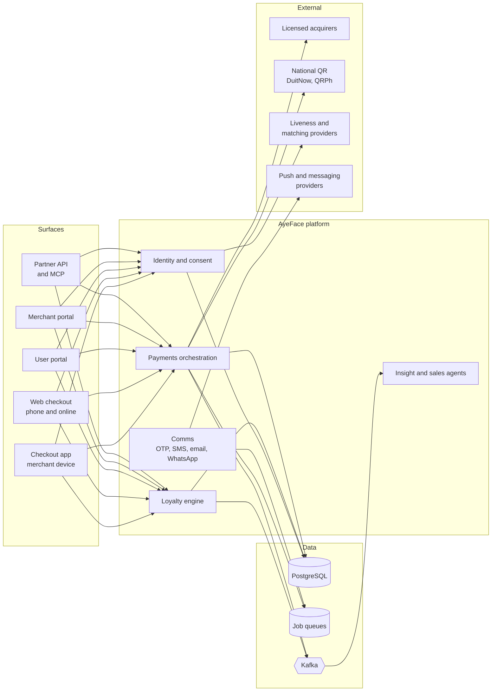
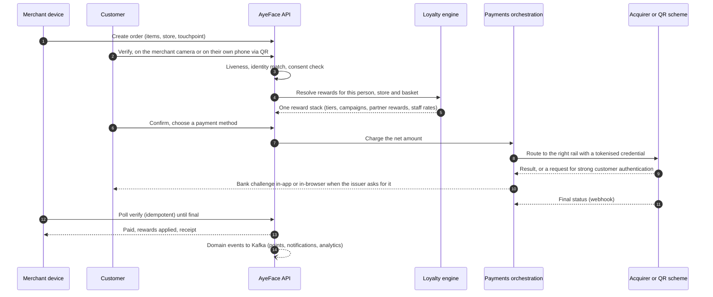
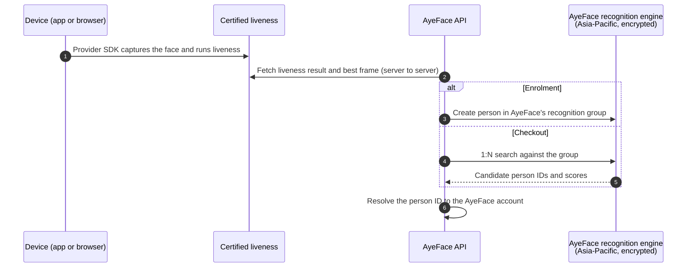

# AyeFace Architecture

**Last reviewed:** 27 October 2026 · **Maintained by:** Aye Engineering · **Review cadence:** quarterly

AyeFace is a consent-based identity, loyalty and payments platform. A person who chooses to enrol is
verified at a participating checkout, the merchant's loyalty rules resolve into one reward stack, and the
payment is routed to the right acquirer or national scheme, in a single interaction. This document
describes how the platform is built. For why it exists, read the [whitepaper](https://aye-ai.org/whitepaper).
For our security and compliance posture, see [Security & Compliance](https://aye-ai.org/security).

---

## At a glance

| Layer | What we run |
|---|---|
| **Client surfaces** | Native checkout app for merchant devices (React Native, iOS and Android) · Web checkout for phones and online stores (React, Vite, TanStack Query) · User portal (React) · Merchant and admin portal (SvelteKit) |
| **Services** | TypeScript end to end: NestJS, Express and SvelteKit server routes on Node.js and Bun |
| **Data** | PostgreSQL as system of record · one shared schema across services · queues for background work · Kafka event streaming |
| **Payments** | Multi-acquirer orchestration behind one gateway interface · national QR schemes (DuitNow, QRPh) · tokenised credentials · signature-verified webhooks · strong customer authentication |
| **AI** | Python services on Vertex AI, PyTorch, LangChain and FAISS · MCP interface for AI assistants and AI Agents |
| **Platform** | Google Cloud · Kubernetes (GKE) · GitOps with Argo CD · Helm · Cloud KMS |
| **Quality** | GitHub Actions · SonarQube quality gates · Dependabot · Architecture Decision Records · lint-enforced module boundaries |

---

## System context

---

## Life of a checkout

The customer can always choose to pay without scanning; card, QR and wallet payments work at every
touchpoint.

---

## Payments

**Orchestration across acquirers and schemes.** A charge is routed by market, method and merchant
configuration to one of several licensed acquirers, or to a national QR scheme. Each provider sits behind one
gateway interface, and a shared contract test suite runs against every gateway, so adding a rail does not
change checkout code. Settlement remains with the acquirer; AyeFace orchestrates, it does not hold merchant funds.

**Tokenisation.** Card details are captured on processors' hosted surfaces. We store provider tokens and
non-sensitive display data (brand, last four digits, expiry), never full card numbers.

**Strong customer authentication on stored credentials.** When an issuer asks to re-authenticate a stored
card, the API returns a `next_action`. The native app presents the bank challenge with the platform SDK and
the web checkout does the same in the browser. The client then confirms the outcome through an idempotent
verify endpoint until the payment is final. Each attempt carries an expiry; a customer closing the
challenge is handled locally, without waiting on a poll.

**Webhooks and reconciliation.** Provider webhooks are signature-verified and logged, then reconciled against
orders, and every order resolves
through the same verify path whichever rail paid it, so card, QR and wallet payments share one state
machine.

**Payment and loyalty are decoupled.** Rewards resolve before payment and apply whatever rail the customer
chooses, including cash and cards outside AyeFace.

---

## Identity and biometrics

- **Certified liveness, more than one engine.** Liveness runs behind a provider interface. The engine is chosen per store and
  read from the checkout session on the server, never from the client request.
- **Matching.** Recognition runs on encrypted templates that cannot be turned back into a face, in an engine
  operated with a certified enterprise partner in the Asia-Pacific region. AyeFace stores a person ID per account,
  not images, and each capture is deleted within 10 minutes.
- **Ambiguity handling.** Checkout does not guess between close candidates; an ambiguous match requires an extra
  verification step before anything is paid.
- **Merchants receive no biometric data.** Merchants see store activity and the customer's chosen payment options.
- **Consent first.** Enrolment is opt-in, and customers can pay by card, QR or wallet without scanning.
- **Deletion reaches the provider.** Deleting an account removes the person from the recognition group as well as
  from AyeFace's own records, and cleans up stored payment consents.

---

## Loyalty engine

- **Deterministic resolution.** Tiers, campaigns, partner rewards and staff rates resolve into one stack per
  checkout, so the counter shows one correct total.
- **Multi-entity by design.** Workspaces, stores and touchpoints are modelled as tenants from the start, with
  the tenant resolved on every request and plans applied per store.
- **Collab Hub.** Joint campaigns between merchants, with earn-here, redeem-there value settled between
  partners. AyeFace performs the matching, so merchants do not see each other's customers.
- **Origin ID attribution.** A reward can be traced from the campaign that issued it to the outlet where it
  was redeemed.

---

## Data

- **PostgreSQL** is the system of record. A shared schema package owns the tables more than one service reads,
  with versioned migrations.
- **Shared tables are a contract.** Migrations on tables other services read are additive only; cross-service
  writes go through an API rather than straight to another service's tables.
- **Encryption.** TLS 1.3 in transit and AES-256 at rest, with signing keys held in Google Cloud KMS.
- **Residency.** Services, databases and the face recognition group run in the Asia-Pacific region. Retention periods are set out in the
  [Privacy Policy](https://aye-ai.org/privacy).
- **Analytics.** Embedded Apache Superset dashboards for merchants, fed from the operational data.

---

## AI

- **Insight agent.** Answers a merchant's plain-language question with a number, not a dashboard: retrieval over
  the merchant's schema (FAISS, sentence-transformers), SQL generation and validation, and Vertex AI models.
- **Sales agent.** Ranks the upsell for the person actually at the counter, using models built in PyTorch and
  scikit-learn on purchase events consumed from Kafka.
- **MCP.** The same loyalty engine is callable by AI assistants and AI Agents through AyeFace MCP, in early
  access alongside the partner API.
- **Review before effect.** AI suggests; merchants review changes before they go live.

---

## Platform and delivery

- **Containers on Kubernetes (GKE)**, built as minimal multi-stage images; the newest services run as non-root.
- **GitOps.** Every environment is declared in the repository and deployed by Argo CD, with Helm charts per service
  and separate dev and prod environments.
- **CI.** GitHub Actions on every change, SonarQube quality gates, and Dependabot for dependency and base-image
  updates.
- **Observability.** Error tracking with Sentry and structured JSON logging with redaction of sensitive fields.

---

## How we engineer

- **Decisions of record.** Significant choices are written down as Architecture Decision Records. The merchant
  portal alone carries nearly 50, from session design to how a request is refused.
- **Shared packages over copies.** Enums, constants, pure functions, the data layer and messaging live in
  shared packages, so services stop maintaining drifting copies.
- **Boundaries enforced by tooling.** Module structure and import boundaries are lint rules, not conventions.
- **Tests split by what breaks them.** Unit, integration and contract suites run per repository in CI; every
  payment gateway must pass the same contract tests.
- **Feature flags.** Features ship behind flags and unlock per plan, store by store.

---

## Key decisions

A few of the choices on record, with what each one cost us. Each record states the decision, the reason and
the consequences, and is superseded by a new record rather than edited.

| Decision | Why | What we accepted in return |
|---|---|---|
| **An opaque server-side session, not a stateless token.** The browser holds an id in an httpOnly cookie. | Revocation has to be immediate: a forced password reset, a 2FA reset or a permission change must end every session at once. A stateless token cannot be withdrawn before it expires. | One indexed read per request, on a tier that reads the database on every request anyway. Sessions are never cached, because a revoked session served from cache was not revoked. |
| **Tenant scope is a type.** A request may name a workspace; only a resolver working from the verified session may grant one. | The request is client-controlled, so it can select but never authorise. Admins act across tenants, so a blanket "ignore the request" rule would break every admin screen. | There is no other way to construct a tenant context. Every module ships a cross-tenant test that expects 404, not 403, so a probe learns nothing about what exists. |
| **Rate limits that guard a credential, a code or money fail closed.** | The operations an attacker would grind need the strongest guarantee, while general traffic should stay available. | Every new limit must declare which way it fails. |
| **New passwords are screened against known breaches**, using a k-anonymity range lookup. | Credential stuffing relies on reused leaked passwords. Composition rules are discouraged by NIST SP 800-63B, and offline top-N lists miss common variants. | Only a short hash prefix ever leaves our servers, never the password. |
| **A price is an effective-dated version, never an edited value.** | Editing a price in place mis-charges: a scheduled change bills today, and an issued invoice could move if anything re-read the catalogue. | Every price read takes an "as of" date. A version already in effect is a fact and cannot be edited, only superseded. |
| **We redact logs with our own deny-list**, matched at any depth and including the message text. | Path-based redaction cannot express "this field name, anywhere", and never sees the message, which is where an interpolated phone number or address is most likely to land. | We maintain the redaction walk ourselves rather than use the logging library's built-in option. |
| **The audit log is append-only and partitioned by UTC month**, with a default partition as a backstop. | A partition bound written without a time zone resolves differently per environment, and a missing month would make Postgres refuse the insert and roll back the payment or approval that wrote it. | A maintenance job keeps a year of partitions ahead, and rows reaching the default partition raise an error-level alarm. |

---

## What we are working on

We publish this because the hard parts are where the interesting engineering is.

- **One data layer.** Consolidating every service onto one shared data contract, so each service reads and writes
  the same schema.
- **Merchant portal v2.** A multi-entity rebuild in SvelteKit, with workspace routing and a permission model
  designed for franchises and groups.
- **Payment routing.** More acquirers and schemes per market, with consistent strong customer authentication
  across native and web.
- **More of the estate on GitOps**, so every environment is reproducible from the repository.
- **Integrity anchoring.** A blockchain-anchored layer for tamper-evident consent and event proofs, with hashed
  references only and no personal or biometric data on-chain.

---

## Further reading

- [Whitepaper](https://aye-ai.org/whitepaper) · [Security & Compliance](https://aye-ai.org/security) ·
  [Privacy Policy](https://aye-ai.org/privacy)
- [Developers](https://aye-ai.org/developers) (partner API) · [AyeFace for Builders](https://aye-ai.org/builders) (API and MCP)
- Careers: [aye-ai.org/careers](https://aye-ai.org/careers) · Contact: [aye-ai.org/contact](https://aye-ai.org/contact)
